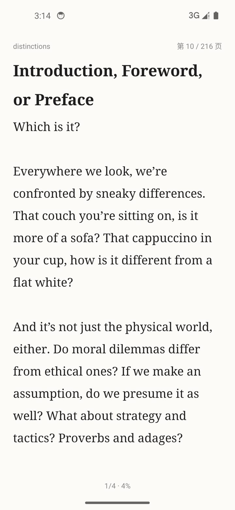
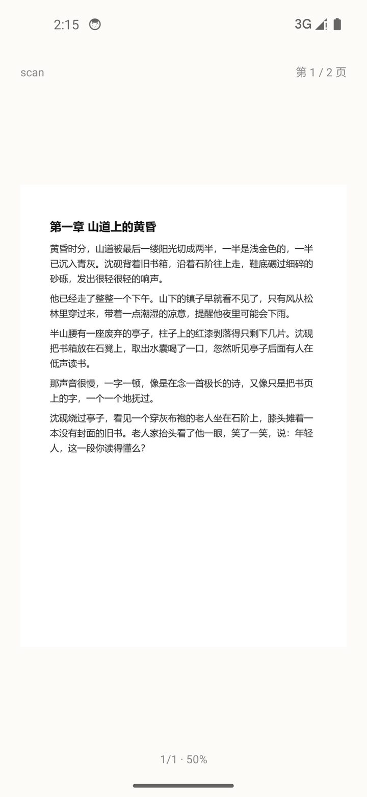
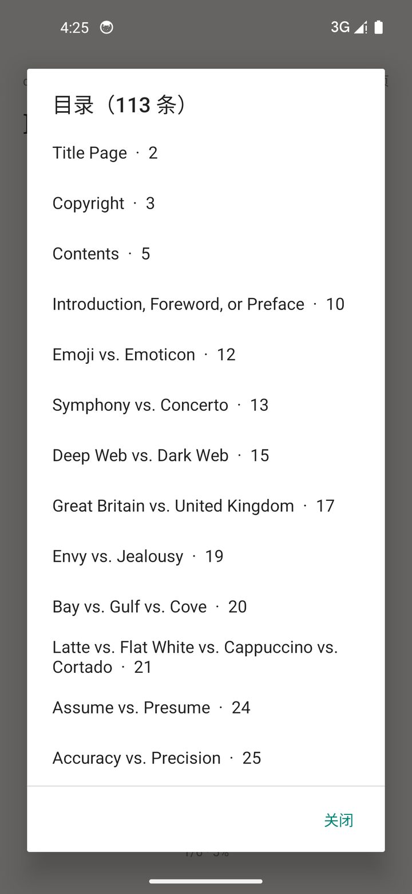
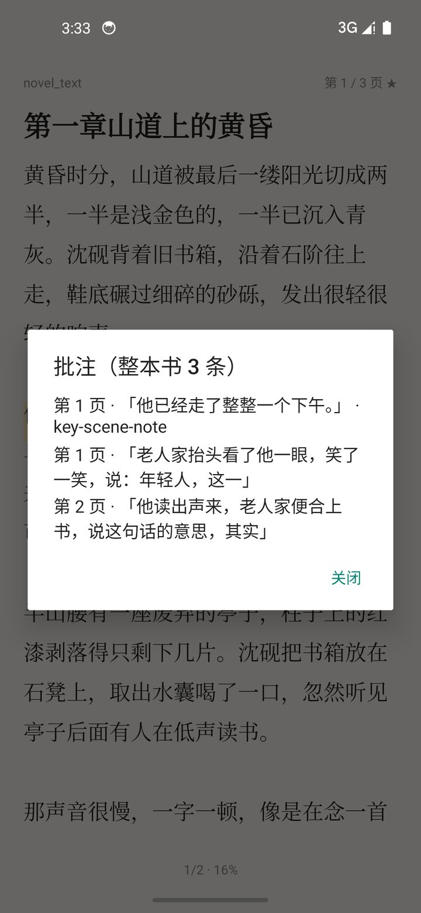

# NovelReader


一款离线优先的 Android 本地小说阅读器。导入 PDF 或 TXT 后，它把页面上的文字重新排版成适合手机阅读的连续文本；没有文字层的扫描页会用本地 OCR 识别后再排版。

不联网，不申请存储权限，没有广告和内购。



## 特性

- **SAF 导入**：通过系统文件选择器读取 PDF / TXT，复制到应用私有目录，不申请存储权限
- **文字层优先**：PDF 有文字层时直接提取，导入后立即可以阅读
- **扫描页 OCR**：使用 ML Kit 中文识别（模型随 APK 打包，完全离线），按距离当前页的远近依次处理，可随时取消与继续
- **重新分页**：按屏幕宽高、字号、行距、边距实时分页，支持日间 / 护眼 / 米黄 / 深色四种主题
- **版面还原**：识别标题层级、粗体与斜体、页眉页脚、双栏排版、目录层级与首行缩进
- **图片页**：整页扫描图与书内插图单独成页，支持双击放大、双指缩放、全屏查看
- **书签与批注**：长按选中整句高亮、写笔记，图片页可写整页笔记；支持列表跳转与 Markdown / JSON 导出
- **PDF 大纲**：优先使用 PDF 自带书签作为目录，按章节层级显示并直接跳页；没有书签时退回按页预览
- **进度记忆**：退出、重进、旋转屏幕后回到原来的文字位置，不依赖重新分页后的页码
- **错误处理**：空白页不记为失败，渲染失败自动降低分辨率重试，失败页可单独列出与重试

## 截图

| 阅读 | 图片页 |
| --- | --- |
|  |  |

| 目录 | 批注 |
| --- | --- |
|  |  |

## 工作原理

### 节（Section）

PDF 以「一页 = 一节」为单位存储，TXT 按段落边界切分为约 3000 字一节。OCR 是逐页完成的，如果整本书连续分页，后到达的 OCR 文字会改变前面页面的字符偏移，已保存的阅读位置就会漂移；按节独立分页可以避免这个问题。

### 文字层与 OCR

导入时逐页调用 `PDFTextStripper` 提取文字，有效字符达到阈值即标记为 `TEXT`，否则标记为 `PENDING`。`PENDING` 的页面由 OCR 队列渲染成位图后识别，识别结果写回同一节的缓存文件。

### OCR 队列

- 应用级协程作用域，可取消
- 目标页按与当前阅读页的距离排序，优先保证正在看的内容可读
- 每页渲染宽度 1600px，识别后立即回收位图，任何时刻只保留一张页面位图
- 每页识别完成即写入，重启不会重复识别
- 空白页（暗像素比例低于 0.2%）标记为 `BLANK`，不计入失败
- 渲染失败时按 1600 / 1100 / 800px 依次降级重试

### 分页

`StaticLayout` 使用与绘制相同的 `TextPaint` 测量每一行，按可用高度切页并记录字符区间；`ReaderView` 用同一套参数重建布局绘制，保证测量与显示一致。字号、行距、边距变化时，以当前页起始字符为锚点重新分页。

### 版面分析

`PageLayoutAnalyzer` 从 `TextPosition` 重建行与块：

- 段落阈值按本页行距自适应，避免「每行一个块」
- 行首缩进大于 0.6 个字号、或行距明显变大时开始新段落
- 上下 7% 范围内的页眉页脚与纯页码会被剔除
- 双栏页面按中线切分，先左栏后右栏
- 字号相对于正文的比值决定标题层级，字体名映射粗体与斜体
- 短行占多数的块视为目录 / 索引，逐条成块并保留缩进层级
- 拉丁文本按字符间距重建词间空格，CJK 不补
- 插图通过 `PDFGraphicsStreamEngine` 取 CTM 图片矩形，过滤装饰图与整页图后按垂直位置插入

### 目录

优先读取 PDF 自带的书签树（`PdfOutline`）：

- 递归遍历 `PDOutlineItem`，用目的地里的 `PDPage` 定位页号；页面对象每次解析都会重新创建，因此按 COS 对象比较而不是 Java 引用
- 结果展平为 `TocItem(title, pageIndex, level)`，导入时写入 `books/<id>/outline.json`
- 菜单「目录」按层级缩进显示并直接跳页；没有书签的 PDF 与 TXT 退回按页 / 按节预览
- 旧版本导入的书籍首次打开目录时补解析一次，之后走缓存

## 技术栈

| 模块 | 方案 |
| --- | --- |
| 语言与 UI | Kotlin 1.9.24，Android 原生 View（无 Compose） |
| PDF 文字层 | [PdfBox-Android](https://github.com/TomRoush/PdfBox-Android) 2.0.27.0 |
| 页面渲染 | `android.graphics.pdf.PdfRenderer` |
| 离线中文 OCR | ML Kit `text-recognition-chinese:16.0.1`（bundled） |
| 书签与批注 | Room 2.6.1 + KSP |
| 构建 | AGP 8.5.2，Gradle 8.9，JDK 17 |

最低支持 Android 7.0（API 24），targetSdk 34。

## 构建

需要 JDK 17 与 Android SDK 34，并设置 `ANDROID_HOME` 或 `local.properties` 中的 `sdk.dir`。

```bash
git clone https://github.com/<your-name>/<repo>.git
cd <repo>
./gradlew assembleDebug
```

Windows 下使用 `gradlew.bat`。产物位于 `app/build/outputs/apk/debug/app-debug.apk`，约 54 MB（包含中文 OCR 模型）。

安装到已连接的设备：

```bash
adb install -r app/build/outputs/apk/debug/app-debug.apk
```

## 使用

1. 首页点击「导入文件」，选择 PDF 或 TXT
2. 正文左侧 1/3 点击上一页，右侧 1/3 点击下一页，中间点击打开菜单
3. 菜单中可以调整字号、行距、边距与背景，切换「图片页：单独显示 / 仅文字」和「排版：普通重排 / 高度还原」
4. 长按正文选中整句，可以高亮或写笔记；点已高亮文字可编辑笔记、改颜色或删除
5. 对已导入的 PDF，菜单中的「重排版面」可以按当前规则重新分析，保留已完成的 OCR 结果

面向普通读者的完整操作说明（安装、导入、翻页、批注、常见问题）见
[docs/使用说明.txt](docs/使用说明.txt)。

## 数据存储

所有数据都保存在应用私有目录，不写入外部存储。

| 数据 | 位置 |
| --- | --- |
| 书架与阅读进度 | `SharedPreferences("library")` |
| 阅读设置 | `SharedPreferences("reader_settings")` |
| 源文件 | `files/books/<bookId>/source.pdf` 或 `source.txt` |
| 每节正文与 OCR 结果 | `files/books/<bookId>/sections/<page>.json` |
| 书签、批注、整页笔记 | Room 数据库 `novel_notes.db` |
| 导出文件 | `Android/data/com.dsh.novelreader/files/exports/` |

## 目录结构

```
app/src/main/java/com/dsh/novelreader/
├── NovelApp.kt
├── data/
│   ├── Block.kt              # 文本块、图片块、样式区间
│   ├── Book.kt               # Book / Section / SectionState
│   ├── BookStore.kt          # 每节 JSON 读写
│   ├── LibraryStore.kt       # 书架与阅读进度
│   ├── ReaderSettings.kt     # 字号、行距、边距、主题
│   ├── Toc.kt                # 目录条目
│   └── notes/                # Room 实体、DAO、数据库与导出
├── pdf/
│   ├── Importer.kt           # 导入、逐页文字层、TXT 分节
│   ├── PageLayoutAnalyzer.kt # 版面分析
│   ├── PdfOutline.kt         # PDF 书签解析
│   ├── PdfPageRenderer.kt    # 单页渲染
│   └── PageImageCache.kt     # 页面位图缓存
├── ocr/
│   ├── OcrQueue.kt           # OCR 队列、进度与缓存
│   └── OcrBlocks.kt          # 识别结果转文本块
├── reader/
│   ├── Pages.kt              # 分页与位置定位
│   ├── ReaderView.kt         # 自绘阅读视图
│   └── TextPaginator.kt      # StaticLayout 分页
├── ui/
│   ├── HomeActivity.kt
│   ├── ReaderActivity.kt
│   ├── ZoomImageView.kt
│   └── BookAdapter.kt
└── util/
    └── TextUtil.kt
```

## 已知限制

- 每个 PDF 页独立分页，页面末尾可能出现不满的一屏；这样可以在 OCR 逐步完成时保持阅读位置稳定
- 长按选择以句为单位，暂不支持拖动句柄自由选区
- 插图裁剪依赖内容流中的图片矩形，使用蒙版或拼贴的复杂插图可能只能取到外接矩形
- OCR 结果存在错字，倾斜、双栏、竖排或低清晰度扫描会降低准确率，可用「查看原页」对照
- 没有书签的 PDF 只能按页生成目录预览，无法还原章节名

## 版本记录

见 [CHANGELOG.md](CHANGELOG.md)。

## 许可证

[MIT](LICENSE)

## 第三方组件

- PdfBox-Android：Apache-2.0
- ML Kit Text Recognition：Google 条款
- AndroidX / Room / Kotlin 协程：Apache-2.0
